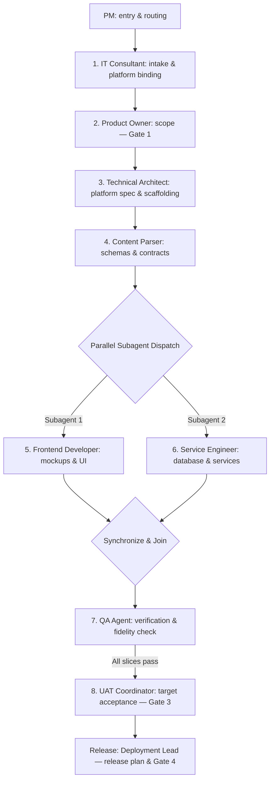

# 🚀 Multi-Agent SDLC Swarm for Solo Founders

> **Build and ship enterprise-grade software as a solo founder, powered by an AI agentic swarm.**

[📊 **Launch Interactive Visualizer Dashboard (`docs/progress.html`)**](docs/progress.html)

---

## ⚡ Quickstart: Create a New App in 3 Steps

Use this repository as a template whenever you start a brand-new project:

### 1. Create Repo from Template on GitHub
1. Navigate to [**github.com/harip/pm-skills**](https://github.com/harip/pm-skills).
2. Click the green **"Use this template"** button (top right) ➔ **"Create a new repository"**.
3. Name your repository (e.g. `my-dream-app`), select Public/Private, and click **"Create repository"**.

### 2. Clone & Open in Antigravity IDE
Open your terminal and run:
```bash
git clone https://github.com/harip/my-dream-app.git
cd my-dream-app
```
Then open this folder in **Antigravity IDE** (or your editor).

### 3. Kick Off the AI Swarm by Platform!

Launch directly for your target platform in the root workspace:

```text
/pm ios start "My iPhone app pitch" [balanced|autopilot|supervised]
/pm android start "My Android app pitch" [balanced|autopilot|supervised]
/pm web start "My web SaaS pitch" [balanced|autopilot|supervised]
```

- **`balanced`** (default): Stops for your sign-off at 4 key milestones (Scope, UI Mockups, UAT, Release).
- **`autopilot`**: Auto-advances across phases, pausing only for Gate 2 mockups, DB setup, UAT, and Release.
- **`supervised`**: Pauses for your approval after *every single phase*.

*(You can also change modes at any point later by typing `/pm mode <mode>`)*

---

## 🧪 Isolated Test-Drive Mode (`sandbox/`)

Want to test drive an idea without committing code to your repo? Add `test`:

```text
/pm test <ios|android|web> "Your app pitch" [mode]
```
- Completely isolated in `sandbox/` (automatically gitignored).
- Maintains its own project status and dashboard.
- Clean up anytime with `/pm test clean`.

---

## 📱 Platform-Specialized Tracks

Instead of generic cross-platform approximations, the swarm provides dedicated platform-specialized tracks:

| Platform Track | Command | Core Tech Stack | UI & Design System | Target Distribution |
|---|---|---|---|---|
| **iOS** | `/pm ios start "..."` | React Native (Expo SDK 51+), `expo-sqlite`, Skia, Reanimated | Apple HIG (`12_apple_design`), SF Pro | Apple TestFlight / App Store |
| **Android** | `/pm android start "..."` | React Native (Expo SDK 51+), `expo-sqlite`, Keystore | Material Design 3, dynamic elevation | Google Play Console (AAB) / EAS |
| **Web** | `/pm web start "..."` | Next.js 14+ (App Router), `Dexie.js` (IndexedDB), Drizzle | Tailwind CSS, Radix, ARIA a11y | Vercel / Cloudflare Pages |

---

## 💻 Swarm Commands (`/pm`)

| Command | What it Does |
|---|---|
| `/pm <ios\|android\|web> start "..."` | Start a production project in root workspace for target platform. |
| `/pm <ios\|android\|web> start "..." <mode>` | Start directly in `autopilot`, `supervised`, or `balanced`. |
| `/pm test <ios\|android\|web> "..."` | Run an isolated test drive in `sandbox/` (gitignored). |
| `/pm test clean` | Wipe the `sandbox/` folder. |
| `/pm mode <mode>` | Change mode at any time (`balanced`, `autopilot`, `supervised`). |
| `/pm resume` | Resume from where you left off (reads saved state). |
| `/pm status` | Check current phase, mode, platform, and next step. |
| `/pm next` | Force execute the next step. |
| `approved` | Accept the pending gate review and advance to next phase. |
| `/pm help` | Show all available commands. |

---

## 👥 The 8-Phase Development Process

Every user story is engineered as a complete vertical feature slice (UI through database):



---

## 📂 Skill & Swarm Architecture

```text
.agents/
├── rules/
│   ├── GLOBAL_RULES.md         # Single authority for SDLC swarm gates & statuses
│   └── 13_caveman.md           # Terse output communication standard
│
└── skills/
    ├── core/                   # Shared Swarm Lifecycle Governance
    │   ├── 00_pm/              # Entry point, /pm commands & sandbox router
    │   ├── 01_it_consultant/   # Discovery, intake & platform binding
    │   ├── 02_product_owner/   # PRD, INVEST user stories & NFRs
    │   ├── 04_content_parser/  # JSON Schemas, Zod contracts & mock fixtures
    │   ├── 10_orchestrator/    # State engine & minimalist progress dashboard
    │   └── 11_architecture_reviewer/ # Cross-phase zero-trust auditor
    │
    └── platforms/              # Platform Implementation Tracks
        ├── ios/                # React Native/Expo, Apple HIG, Skia, TestFlight
        ├── android/            # React Native/Expo, Material 3, Google Play
        └── web/                # Next.js App Router, Tailwind, IndexedDB, Vercel
```
